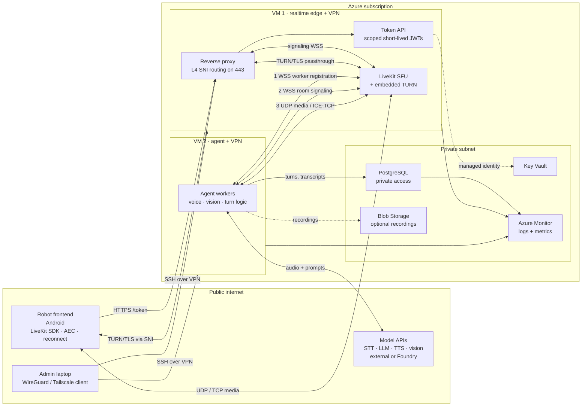
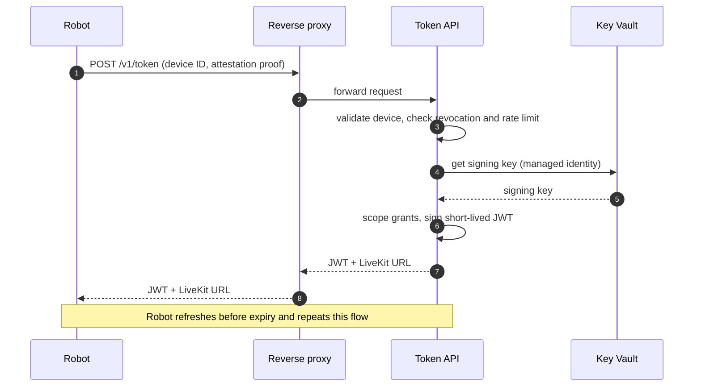
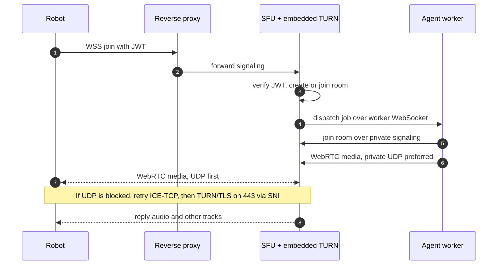
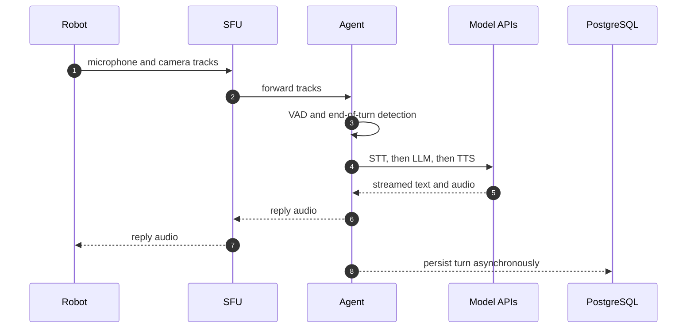
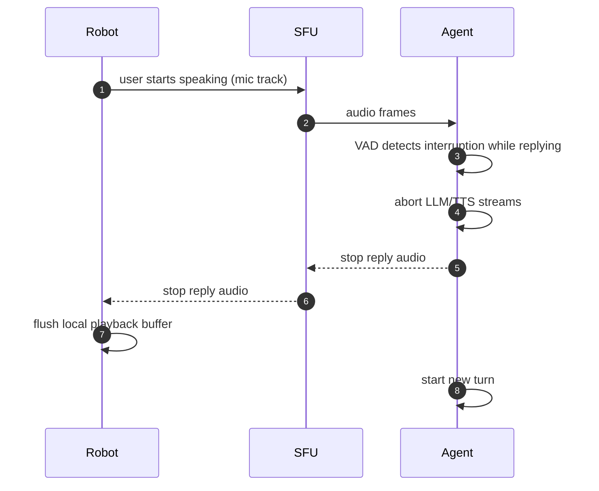
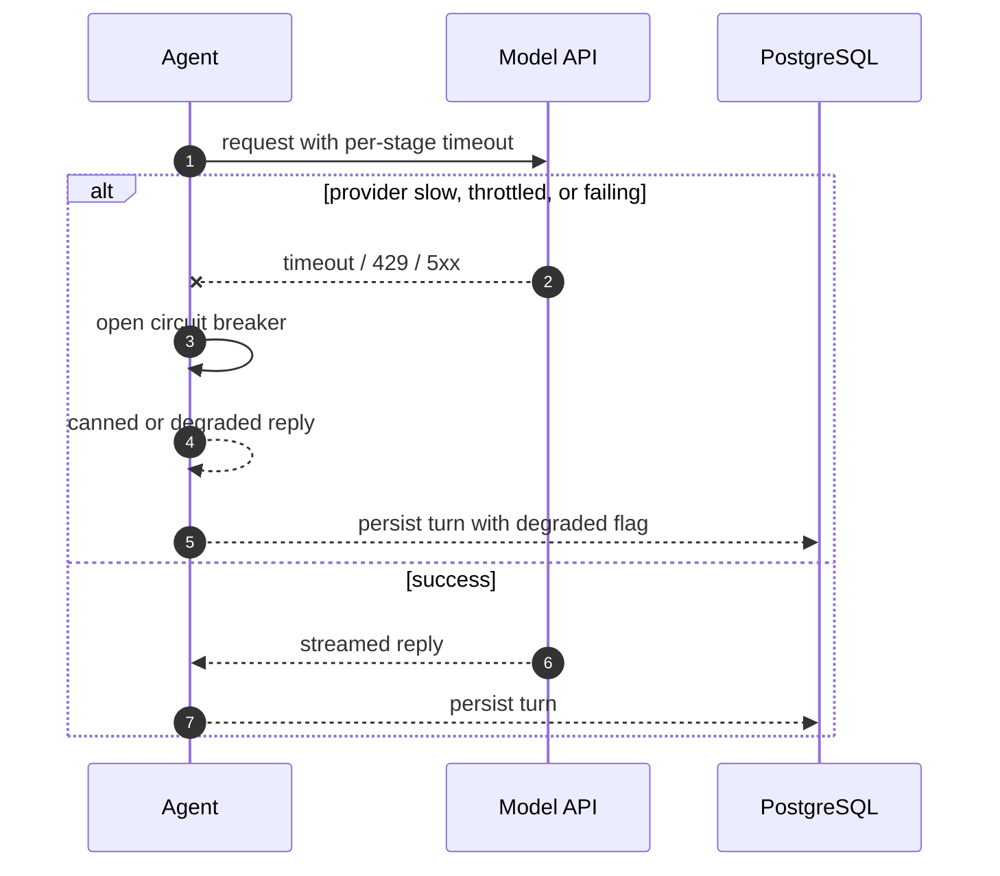

# FCM Robot — Final Architecture

| Field | Value |
| --- | --- |
| Status | Final — approved target architecture for pilot |
| Version | 1.0 |
| Date | 2026-10-22 |
| Scope | Robot client, Azure-hosted realtime edge, agent tier, data tier, admin access |
| Source | Architecture review session (`claude.ai/share/b10db487-ed7b-4833-8321-79a13ea1ff8b`) |
| Audience | Engineering, platform, security, product |

> **Basis of this document.** It consolidates the original Azure + LiveKit design, the review findings, the corrections agreed during the session, and the final diagrams (architecture v6 and the three sequence flows). The original attached source file was not retrievable from the shared snapshot (`viewer_can_access_files: false`), so component details beyond what the review states are marked as **assumptions** or **open questions** rather than presented as fact. Configuration keys and default ports are illustrative and must be verified against the installed LiveKit, Caddy, and Azure versions.

---

## 1. Executive summary

FCM Robot is a voice-and-vision robot with an Android frontend that connects to a LiveKit SFU on Azure. Inference runs in LiveKit agent workers, not on the robot. The target architecture keeps the original pragmatic shape but makes five material changes:

1. **Split the realtime edge from the agent tier.** VM 1 runs the reverse proxy, Token API, and LiveKit SFU (with its embedded TURN server). VM 2 runs agent workers. Agent CPU spikes and model stalls can no longer degrade media forwarding for every session.
2. **Treat TURN as a required, configured capability — not an extra component.** TURN is built into `livekit-server`; it must be enabled, given a dedicated DNS name and certificate, and exposed on a network path that restrictive sites allow.
3. **Route port 443 by SNI.** A layer-4-capable proxy (Caddy with the layer-4 plugin, or NGINX `stream`) sends `turn.example.com` traffic to the SFU's TURN/TLS listener and everything else to the API/signaling listeners. This removes the need for a second public IP.
4. **Make the agent-to-SFU link explicit.** It is not one link but three connections: worker registration (WSS/TCP), room signaling (WSS/TCP), and WebRTC media (UDP, ICE-TCP fallback). All three can and should stay on private addresses inside the VNet.
5. **Replace Bastion/JIT with VPN-only administration for the pilot.** SSH is closed to the internet; administrators reach both VMs over WireGuard or Tailscale.

The pilot accepts a documented single-VM concentration risk on the realtime edge. Before real users, the required order of work is: TURN/TLS and the port plan; device authentication and token scoping; agent/SFU separation; observability; data-privacy controls.

---

## 2. Context and constraints

### 2.1 Workload

- **Robot frontend:** Android device with microphone, camera, and speaker. Uses the LiveKit Android SDK. Long-lived sessions (minutes to hours) on networks the operator does not control.
- **Interaction model:** Real-time spoken conversation with optional vision. The robot publishes microphone and camera tracks; the agent subscribes, decides when the user's turn ends, calls STT/LLM/TTS (and optionally vision/emotion models), and publishes reply audio.
- **Inference placement:** External model providers or Azure Foundry endpoints, reached only from the agent tier.
- **Data:** Session/turn transcripts, emotion inferences, and optionally audio/video recordings.

### 2.2 Original design as reviewed

The reviewed design placed the reverse proxy, Token API, LiveKit SFU, and agent worker on a single Azure VM, with PostgreSQL on private access, secrets in Key Vault via managed identity, short-lived JWTs issued by the Token API, and optional recordings in Blob Storage. That design is sound for a prototype; the review's concerns were concentration of risk, networking details, device authentication, privacy, observability, and admin access.

### 2.3 What changed during the review

| # | Original position | Final position |
| --- | --- | --- |
| 1 | Proxy, Token API, SFU, and agent on one VM | Edge components on VM 1, agent workers on VM 2 |
| 2 | TURN drawn as a separate, optional component | TURN is embedded in `livekit-server`; it is required to configure, not to deploy |
| 3 | TURN needed a second public IP or a non-443 port | A single IP works with layer-4 SNI routing and a dedicated TURN hostname |
| 4 | "Private link" between agent and SFU | Three explicit connections: registration, signaling, media |
| 5 | One-way arrows from robot to SFU | Media and signaling are bidirectional; only data-tier writes are one-way |
| 6 | Azure Bastion or JIT for admin access | VPN-only admin access (WireGuard or Tailscale) for the pilot |
| 7 | LiveKit config values implied as fixed | Version-dependent; verify keys against the installed release |

### 2.4 Assumptions

- **A1.** Concurrent robots in the pilot are small (single digits to low tens). No figure was confirmed in the session.
- **A2.** Robots are deployed in at least some networks the operator does not control (offices, schools, hospitals, guest Wi-Fi). This is why TURN is mandatory.
- **A3.** Robots are Android devices; some may not ship Google Mobile Services, so Play Integrity cannot be the only attestation mechanism.
- **A4.** Model providers are external to Azure or Foundry-hosted, and their latency is outside the platform's control.
- **A5.** A single Azure region is acceptable for the pilot; robots and model endpoints are closest to that region.
- **A6.** Multi-tenancy is not required for the pilot. If it is, token claims and database keys must add a tenant boundary.

### 2.5 Goals

- Reliable real-time voice sessions from restrictive networks.
- Media forwarding isolated from inference load.
- Short-lived, least-privilege credentials; no long-lived secrets on robots or disks.
- Clear, testable latency budgets and observability.
- A defensible privacy posture for transcripts, emotion data, and recordings.
- A documented, low-cost path from pilot to production scale.

### 2.6 Non-goals

- Multi-region active/active or multi-SFU clustering in the pilot.
- Kubernetes migration.
- On-robot inference.
- Full-duplex speech-to-speech as the initial implementation.
- Building a custom media stack; LiveKit remains the SFU.

---

## 3. System context

### 3.1 Target architecture



**Reading the diagram**

- Two-headed arrows are two-way traffic. Single arrows are one-way writes. Dashed arrows are optional or asynchronous.
- Trust boundaries are the public internet, the Azure subscription, each VM, and the private subnet.
- `TURN/TLS via SNI` and `signaling WSS` share port 443 but are separated by hostname.
- The agent's three connections to the SFU are all private; none traverse the public proxy.

### 3.2 Actors and external systems

| Actor / system | Responsibility | Trust level |
| --- | --- | --- |
| Robot frontend (Android) | Capture mic/camera, play reply audio, manage session, reconnect, cancel playback | Untrusted device; authenticated per device |
| Admin laptop | SSH administration over VPN | Trusted operator; per-user credentials |
| Model APIs | STT, LLM, TTS, vision/emotion | External dependency; least-privilege keys held by agent |
| Azure subscription | Hosts edge, agent, and data services | Trust boundary |
| Key Vault | Holds LiveKit signing secret, model keys, DB credentials | High trust; managed identity only |
| Azure Monitor | Logs, metrics, alerts | Operational visibility |

### 3.3 Trust boundaries

1. **Internet → VM 1.** Only 443/TCP and the TURN/media ports are reachable.
2. **VM 1 internal.** The proxy is the only internet-facing process; Token API and SFU bind to private/localhost where possible.
3. **VM 1 → VM 2.** Private VNet traffic only, restricted by NSG to signaling and media ports plus the data-tier endpoints.
4. **Agent → model APIs.** Outbound HTTPS with per-provider keys; no inbound path.
5. **VM 2 → data tier.** PostgreSQL over private access; Blob and Key Vault via managed identity.
6. **Admin → VMs.** Reached only through the VPN overlay; no public SSH.

---

## 4. Logical architecture

### 4.1 Component responsibilities

| Component | Host | Responsibilities | Scales with | Failure impact |
| --- | --- | --- | --- | --- |
| Robot frontend | Device | Publish mic/camera, subscribe reply audio, AEC, token refresh, reconnect/backoff, barge-in playback control | Devices | Single session |
| Reverse proxy | VM 1 | Terminate TLS (HTTP layer), L4 SNI routing, forward `/token` to Token API and signaling to SFU, pass TURN/TLS through | Connections and bandwidth | All new sessions fail; active media continues if only the HTTP layer fails |
| Token API | VM 1 | Device authentication, authorization, rate limiting, JWT signing via Key Vault, audit | Token requests | New joins and refreshes fail; existing sessions continue until token expiry |
| LiveKit SFU + embedded TURN | VM 1 | Room state, track forwarding, ICE, TURN relay for blocked networks, webhooks/Prometheus | Participants and media bandwidth | All sessions on the node drop |
| Agent workers | VM 2 | Register with SFU, accept job dispatch, run VAD/turn logic, call models, publish reply audio, persist turns | Concurrent conversations and model load | Only affected sessions; new rooms may go unassigned if no worker is registered |
| PostgreSQL | Private subnet | Devices, sessions, turns, emotion events, recordings metadata, audit | Writes per turn, retention | Persistence degraded; live conversation can continue with buffering |
| Blob Storage | Private subnet | Optional recordings and large artifacts | Recording volume | Recordings lost or delayed; conversation unaffected |
| Key Vault | Private subnet | LiveKit signing secret, provider keys, DB credentials, certificates | Requests | Token signing and provider calls fail |
| Azure Monitor | Managed | Metrics, logs, alerts, dashboards | Telemetry volume | Blind operations; no functional impact |
| Model APIs | External / Foundry | STT, LLM, TTS, vision, emotion | Provider quota | Turn latency or failure; fallback required |

### 4.2 Realtime edge (VM 1)

**Reverse proxy**

- Listens on 443/TCP. Uses a layer-4-capable build (Caddy with the layer-4 plugin, or NGINX `stream`) because plain HTTP reverse proxies cannot route TLS by SNI.
- Routes `turn.example.com` to the SFU's TURN/TLS listener on localhost.
- Routes `api.example.com` and `livekit.example.com` to the internal HTTP listener, which forwards `/token*` to the Token API and everything else to the SFU signaling port.
- Does not proxy media. Normal media goes directly from the robot to the SFU over UDP/TCP.
- Terminates or passes through TLS consistently; if TLS terminates at the proxy for TURN, configure `external_tls` instead of loading certificates in LiveKit.

**Token API**

- Single public purpose: exchange a device identity for a short-lived, tightly scoped LiveKit JWT.
- Validates device identity and attestation, checks revocation and rate limits, binds the room name to the device, and signs with a key retrieved from Key Vault through managed identity.
- Emits audit events for issuance, denial, and refresh.
- Never exposes provider API keys or database credentials to the robot.

**LiveKit SFU**

- Owns rooms, participants, tracks, and permissions.
- Verifies JWTs for both robots and agents.
- Advertises ICE candidates; must advertise a private candidate reachable by the agent and a public candidate reachable by robots.
- Runs the embedded TURN server; TURN is enabled in configuration, not deployed separately.
- Emits Prometheus metrics and webhooks to Azure Monitor.

### 4.3 Agent tier (VM 2)

- One or more agent worker processes. Each worker opens an outbound WebSocket to the SFU, registers as available, and reports load.
- When a room needs an agent, the SFU dispatches a job over that WebSocket. The job carries the room name and join credentials. The worker accepts and spawns an isolated process per session.
- The session process joins the room as a normal participant: WSS signaling, then WebRTC media.
- Runs VAD, end-of-turn detection, STT/LLM/TTS orchestration, optional vision/emotion inference, barge-in cancellation, and persistence of turns.
- Holds model-provider credentials; nothing on VM 1 needs them.
- Can be drained and redeployed without restarting the SFU.

### 4.4 Why the SFU and agent are separate

| Dimension | SFU | Agent |
| --- | --- | --- |
| Work | Forwards encoded packets; no decode | Decodes audio, runs VAD, calls models, may process video |
| Resource profile | Low CPU per stream, latency-sensitive | Heavy, bursty CPU/memory, possibly GPU |
| Scaling unit | Participants and bandwidth | Concurrent conversations and model load |
| Failure isolation | A media node failure affects its rooms | A worker failure affects its sessions only |
| Runtime | Go service | Python/Node with ML libraries |
| Security | Internet-facing, holds LiveKit secret | Holds provider keys and business logic |
| Deploy cadence | Rare, disruptive | Frequent, drainable |
| Placement | Near robots | Near model endpoints or on GPU hosts |

Running them in one process would let one slow turn delay packet forwarding for every session on the host. Even in the pilot, LiveKit treats them as separate processes; the split to separate VMs is the natural next step and is now the target design.

### 4.5 Agent-to-SFU connection model

| # | Connection | Transport | Purpose | Direction |
| --- | --- | --- | --- | --- |
| 1 | Worker registration | WebSocket over TCP (signaling port, default 7880) | Register availability, report load, receive job dispatches | Agent → SFU (outbound), then bidirectional |
| 2 | Room signaling | WebSocket over TCP (same port) | Join room, negotiate tracks and permissions | Bidirectional |
| 3 | Media | WebRTC: UDP preferred, ICE-TCP fallback | Publish reply audio, subscribe robot audio/video | Bidirectional |

Operational consequences:

- Point the agent's LiveKit URL at the SFU's **private** address or internal DNS name, never the public hostname.
- Allow the signaling port, the media UDP port/range, and the ICE-TCP port from VM 2 to VM 1 in the NSG.
- Confirm in session stats that the agent's selected ICE candidate is a private address. If the SFU advertises only its public IP, agent media can hairpin through the public path and add latency or fail.
- If connection 1 drops, existing sessions continue (they run on connection 2/3) but new rooms get no agent. **Alert on registered worker count**, not only on VM health.
- Multiple workers register with the same SFU; the server selects one based on reported load, so agents scale horizontally without extra routing.
- With multiple SFU nodes later, nodes share state through Redis and workers connect to the cluster.

---

## 5. Network architecture

### 5.1 DNS and hostnames

| Hostname | Purpose | Termination |
| --- | --- | --- |
| `api.example.com` | Token API | TLS at proxy, HTTP to Token API |
| `livekit.example.com` | LiveKit signaling (HTTPS/WSS) | TLS at proxy, HTTP/WS to SFU |
| `turn.example.com` | TURN/TLS fallback | TLS passed through to SFU's TURN listener |

A **separate DNS name for TURN is mandatory** because SNI is the only way the layer-4 proxy distinguishes TURN traffic from normal HTTPS.

### 5.2 Port and protocol matrix

| Source | Destination | Port / protocol | Purpose | Exposure |
| --- | --- | --- | --- | --- |
| Robot | VM 1 | 443/TCP (HTTPS) | Token API via proxy | Public |
| Robot | VM 1 | 443/TCP (WSS) | LiveKit signaling via proxy | Public |
| Robot | VM 1 | 443/TCP (TURN/TLS, SNI `turn.example.com`) | Media fallback when UDP is blocked | Public |
| Robot | VM 1 | 3478/UDP (default) | TURN over UDP, if enabled | Public |
| Robot | VM 1 | 7882/UDP (or configured media range) | WebRTC media | Public |
| Robot | VM 1 | 7881/TCP | ICE-TCP fallback | Public |
| Agent (VM 2) | VM 1 | 7880/TCP | Worker registration and room signaling | Private only |
| Agent (VM 2) | VM 1 | 7881/TCP | ICE-TCP fallback | Private only |
| Agent (VM 2) | VM 1 | 7882/UDP (or range) | WebRTC media | Private only |
| Agent (VM 2) | PostgreSQL | 5432/TCP | Persistence | Private only |
| Agent (VM 2) | Model APIs | 443/TCP outbound | Inference | Outbound |
| Token API | Key Vault | 443/TCP | Signing key retrieval | Private endpoint |
| Agent | Blob Storage | 443/TCP | Recording upload | Private endpoint |
| Admin (VPN) | VM 1, VM 2 | 22/TCP over VPN | Administration | VPN only |
| Internet | Any | 22/TCP | — | **Denied** |

> Ports 7880/7881/7882 and 3478 are LiveKit defaults at the time of the session. Confirm the actual keys and defaults for the installed release. If you configure a UDP port range instead of a single mux port, open the whole range in the NSG.

### 5.3 SNI routing on 443

```text
Robot ──TLS ClientHello (SNI=turn.example.com)──> Proxy :443 ──passthrough──> SFU TURN/TLS :5349
Robot ──TLS ClientHello (SNI=api.example.com)───> Proxy :443 ──HTTP layer───> Token API :8080
Robot ──TLS ClientHello (SNI=livekit.example.com)> Proxy :443 ──HTTP layer───> SFU signaling :7880
```

This is what removes the "second public IP" requirement. It requires:

- A proxy build with layer-4 routing (Caddy `layer4` plugin, or NGINX `stream` with `ssl_preread`). Plain HTTP-only Caddy/NGINX cannot do it.
- A dedicated TURN hostname and certificate.
- LiveKit's TURN/TLS listener reachable on localhost/private address from the proxy.

### 5.4 TURN: why it is required

WebRTC media attempts three paths in order:

1. **UDP directly to the SFU.** Works on most home and mobile networks.
2. **ICE over TCP to the SFU.** Many UDP-blocking networks still allow TCP, but often only on 80/443, not an arbitrary port such as 7881.
3. **TURN over TLS on 443.** To a firewall this looks like ordinary HTTPS and is rarely blocked.

Robots are deployed precisely where step 3 is needed: corporate offices, hospitals, schools, hotels, and guest Wi-Fi that block UDP or allow only outbound 80/443. A browser user can switch to a hotspot; a robot at a customer site cannot. Without TURN/TLS those sites fail in a way that is hard to reproduce from the office and looks like "the robot won't connect."

TURN is embedded in `livekit-server` and is **off by default**. Enabling it correctly requires a domain, certificate or `external_tls`, reachable ports, and an accurate external IP.

### 5.5 Private agent path and ICE

- SFU media on the public internet and SFU↔agent media inside the VNet use the same ICE machinery. If the SFU advertises only the public address, agent media may leave the VNet and come back.
- Set the node's private IP and external IP explicitly and test that agent media selects a private candidate.
- NSG rules must cover both public ingress (for robots) and VM-to-VM traffic (for agents); forgetting either is a common deployment error.
- A pilot test should verify in LiveKit logs/stats that the selected candidate for the agent is private.

### 5.6 NSG summary

| Priority | Direction | Source | Destination | Ports | Action |
| --- | --- | --- | --- | --- | --- |
| 100 | Inbound | Internet | VM 1 | 443/TCP | Allow |
| 110 | Inbound | Internet | VM 1 | 3478/UDP, 7882/UDP, 7881/TCP, TURN UDP if used | Allow |
| 120 | Inbound | VM 2 subnet | VM 1 | 7880/TCP, 7881/TCP, 7882/UDP | Allow |
| 130 | Inbound | VPN subnet/interface | VM 1, VM 2 | 22/TCP | Allow |
| 140 | Inbound | VNet | PostgreSQL | 5432/TCP | Allow from VM 2 only |
| 4096 | Inbound | Any | Any | Any | Deny |
| — | Outbound | VM 2 | Model APIs | 443/TCP | Allow |
| — | Outbound | VM 2 | Key Vault, Blob, PostgreSQL | 443/TCP, 5432/TCP | Allow |
| — | Inbound | Internet | VM 2 | Any | Deny |

---

## 6. Security architecture

### 6.1 Device identity and authentication

Whoever obtains a token can enter a room that reaches paid model endpoints and writes transcripts. Device authentication is therefore **the** security boundary, not an implementation detail.

Required controls:

- **Provisioning:** one credential per device, issued at manufacturing or first commissioning. Prefer an X.509 client certificate in the Android Keystore or a hardware-backed key over a bearer device secret.
- **Attestation:** use Play Integrity where GMS is available. Because robots may lack GMS (A3), support hardware-backed key attestation or mTLS as the alternative. Never rely on a self-reported device ID alone.
- **Revocation:** a server-side revoked state checked on every token request; a revoked device must not get a refresh.
- **Rate limiting:** per-device token requests per minute, concurrent sessions per device, and per-IP limits at the proxy.
- **Abuse detection:** alert on token issuance spikes, repeated denials, many rooms from one device, and tokens used from implausible geographies.

### 6.2 Token design

| Claim / property | Value | Rationale |
| --- | --- | --- |
| `sub` | Device ID | Identity is the device, not a user |
| `room` / `roomJoin` | `device.<device_id>` (or a server-assigned session room) | Prevents joining arbitrary rooms |
| Video grants | Publish mic and camera; subscribe | No room admin, no data-channel abuse |
| `ttl` | 10–15 minutes | Short enough to limit replay; long enough to avoid churn |
| `jti` | Unique token ID | Audit and revocation correlation |
| `nbf` / `exp` | Explicit | Reject clock-skewed or expired tokens |
| Audience | LiveKit server | Prevent cross-service reuse |

- **Refresh:** the robot refreshes before expiry and updates its connection; the server must tolerate overlap between old and new tokens.
- **No secrets on the robot:** the robot never holds the LiveKit API secret or provider keys.
- **Signing:** the Token API retrieves the LiveKit signing secret from Key Vault through managed identity; the secret is never on disk.
- **Rotation:** support two active keys during rotation so tokens issued before rotation remain valid until expiry.

### 6.3 Secrets and managed identity

| Identity | Access | Notes |
| --- | --- | --- |
| Token API identity | LiveKit signing secret, TURN credentials if dynamic | Read-only; no provider keys |
| Agent identity | Model provider keys, DB credentials | No Key Vault administration |
| SFU identity | TURN certificate/secret if needed | Minimal |
| Operator identity | Key Vault read via Entra ID, break-glass only | Audited |

- Use **separate managed identities per VM/service**; never share one identity across the edge and the agent.
- Scope Key Vault permissions to only the secrets each workload needs. Anyone with a shell on a VM can read what that identity can read.
- Prefer private endpoints for Key Vault, PostgreSQL, and Blob; disable public network access where possible.
- No long-lived SAS tokens. Use managed identity or short-lived user-delegation SAS for recordings.

### 6.4 Administrative access

The pilot uses **VPN-only administration**, replacing Bastion/JIT:

- Admin laptop runs a WireGuard or Tailscale client.
- Both VMs run the VPN agent.
- Port 22 is closed to the internet in the NSG and allowed only from the VPN interface/subnet.
- SSH key-only login; password authentication disabled. Microsoft Entra ID login for Linux is preferred where available.
- Tailscale connects outbound, so it needs no inbound NSG rule. WireGuard needs a UDP port open.
- Use one mesh or one peer list; revoke a person's access when they leave.
- Tailscale is the lower-effort pilot choice (per-user access, device revocation, no inbound port); plain WireGuard avoids a third-party dependency but requires manual key/peer management.

Bastion or JIT should replace this before production or when more than one person needs admin access. Note that Bastion requires its own `AzureBastionSubnet` and does not live in the data subnet.

### 6.5 Threat model summary

| Threat | Exposure | Mitigation |
| --- | --- | --- |
| Stolen device credential | Attacker joins rooms, consumes model budget, reads transcripts | Per-device cert, attestation, revocation, short TTL, rate limits, anomaly alerts |
| Token replay | Unauthorized room access | Short TTL, `jti`, TLS only, room binding, refresh with overlap |
| Open SSH brute force | Full VM compromise, LiveKit secret and managed identity theft | No public 22; VPN only; key-only auth; audit |
| Over-broad managed identity | Key Vault secret exfiltration | Per-workload identities; least privilege; private endpoints |
| Public data store | Transcript/emotion leakage | Private endpoints, TLS, no public Blob access, short SAS |
| Prompt/tool abuse through robot | Agent performs unintended actions | No privileged tools on the agent; validate model output; scope grants |
| Media interception | Eavesdropping | WebRTC DTLS-SRTP; TLS for signaling and TURN |
| Denial of service on 443 | All new sessions fail | Rate limits at proxy, connection limits, Azure DDoS protection, separate agent tier |
| Supply-chain/model provider outage | Conversation stalls | Timeouts, circuit breaker, canned fallback, provider abstraction |

---

## 7. Data architecture

### 7.1 Stores

| Store | Data | Access | Retention |
| --- | --- | --- | --- |
| PostgreSQL | Devices, sessions, turns, transcripts, emotion events, recording metadata, audit | Agent writes; Token API reads devices; private access only | Configurable; default 30 days for transcripts in the pilot |
| Blob Storage | Optional audio/video recordings, large artifacts | Agent writes via managed identity; no public access | Per consent and policy; lifecycle delete |
| Key Vault | Secrets and certificates | Managed identities only | N/A |
| Azure Monitor | Logs, metrics, traces | Operations | Per workspace retention |
| Local disk on VMs | Ephemeral buffers only | OS and services | No durable state |

### 7.2 Logical schema (sketch)

```text
devices(device_id PK, org_id, model, firmware_version,
        attestation_state, revoked_at, last_seen_at, created_at)

sessions(session_id PK, room_name UNIQUE, device_id FK,
         started_at, ended_at, end_reason, agent_worker_id, region)

turns(turn_id PK, session_id FK, seq, user_text, assistant_text,
      started_at, vad_end_ms, stt_ms, llm_first_token_ms,
      tts_first_byte_ms, total_ms, barge_in BOOL)

emotion_events(event_id PK, session_id FK, turn_id FK NULL,
               label, confidence, model_version, captured_at)

recordings(recording_id PK, session_id FK, blob_path,
           consent_ref, retention_until, created_at)

audit_events(event_id PK, actor, action, target, at, source_ip, result)
```

Notes:

- `turns` holds the latency components needed to debug "the robot felt laggy" without joining raw logs.
- `emotion_events` stores only derived labels and model version, not raw frames, unless separately consented.
- Index `sessions(device_id, started_at)` and `turns(session_id, seq)`.
- Partition or archive `turns` by month if volume grows.

### 7.3 Privacy and compliance

The system stores transcripts, turn-level utterances, emotion inferences, and optionally audio/video. That is sensitive personal data.

Required before real users:

- **Consent:** explicit notice and consent at session start where recording or emotion inference is enabled. Consent reference stored with the recording.
- **Minimization:** default to **no** audio/video recording; record only when a feature or customer explicitly requires it. Do not derive emotion data silently.
- **Retention:** documented limits per data class; automated purge job; deletion on request.
- **Encryption:** TLS in transit, encryption at rest for PostgreSQL and Blob, optional customer-managed keys.
- **Access control:** no public Blob access, no long-lived SAS, least-privilege RBAC, audited reads of recordings.
- **Deletion path:** delete by device/session/tenant, including blobs and derived rows.
- **Regulatory review:** emotion recognition is restricted or regulated in some contexts. The EU AI Act limits emotion inference in workplace and education settings; Singapore's PDPA applies to the personal data itself. Product must confirm the deployment context and jurisdictions before enabling the feature.
- **Log hygiene:** redact transcripts and tokens from application logs; never log JWTs.

---

## 8. Key flows

### 8.1 Token issuance and refresh



The Token API is the security gate. The device checks and the grants in the JWT matter more than anything else in the flow.

### 8.2 Join, dispatch, and media



Media bypasses the proxy. Only signaling and the TURN fallback go through 443.

### 8.3 Conversation turn



The agent sits in the middle of every turn. Its latency budget covers end-of-turn detection, the model round trip, and time to first reply audio.

### 8.4 Barge-in



Both sides must act: the agent cancels model/TTS streams, and the robot flushes its playback buffer. Without the client-side flush, the user still hears queued audio.

### 8.5 Degraded mode and failure handling



Rules:

- Every model call has a timeout and a fallback. A canned reply or text-only mode is better than silence.
- Handle provider 429/5xx with bounded retries plus jitter and a circuit breaker.
- Cap vision frame rate and send frames on change, not continuously, to control quota and cost.
- If persistence fails, buffer locally and retry; do not block the audio path on the database.
- If the worker registration drops, existing sessions continue but new rooms get no agent — alert immediately.

### 8.6 Token refresh

- Refresh at roughly two-thirds of TTL.
- Keep the old connection until the new token is accepted, then swap without dropping media.
- If refresh fails, retry with backoff; surface a clear error to the robot before expiry rather than letting the session die silently.

---

## 9. Performance and latency

### 9.1 Cascaded vs full-duplex

The pilot uses a **cascaded** pipeline: VAD/end-of-turn → STT → LLM → TTS. It is simpler to observe, gives per-stage control, and makes fallbacks straightforward. Full-duplex speech-to-speech offers lower latency and more natural barge-in but reduces control and observability. Treat it as a later experiment, not an initial requirement.

### 9.2 Latency budget (targets, to validate per provider)

| Stage | p50 target | p95 target | Notes |
| --- | --- | --- | --- |
| Robot → SFU network | 30–80 ms | 150 ms | Same region |
| End-of-turn detection | 200–500 ms | 700 ms | Trade-off with false cutoffs |
| STT final result | 150–300 ms | 500 ms | Streaming STT preferred |
| LLM first token | 300–800 ms | 1,500 ms | Provider-dependent |
| TTS first byte | 150–400 ms | 700 ms | Streaming TTS preferred |
| **Voice-to-voice total** | **≤ 1.2 s** | **≤ 2.5 s** | Headline SLO |
| Time to first reply audio | ≤ 800 ms | 1.5 s | Primary perceived metric |

Rules:

- Keep VM 1 and VM 2 in the region closest to both robots and model endpoints.
- Measure each stage as a histogram, not just an average.
- Track "time to first audio" and "end-to-end turn time" as the two headline metrics.
- Review the budget whenever a provider, model, or region changes.

---

## 10. Reliability and failure modes

| Failure | Detection | Impact | Mitigation |
| --- | --- | --- | --- |
| VM 1 loses network | Azure metrics, failed health probe, robot errors | All sessions drop | Static IP, restart policy, automated rebuild from IaC, documented RTO |
| Proxy process dies | Health probe, 5xx rate | New joins and token requests fail | systemd/compose restart, readiness probe |
| SFU process crashes | Process metrics, session drop webhook | Rooms on the node drop | Auto-restart, room re-join, later multi-node |
| TURN misconfigured or blocked | Join failure by network class, ICE stats | Restrictive sites cannot connect | Explicit port plan, per-site connectivity test, TURN on 443 via SNI |
| Agent worker crash | Worker registration count, job failures | Affected sessions end | Restart policy, drain/rolling deploy, multiple workers |
| Worker registration lost | `registered workers` metric | New rooms get no agent; existing continue | Alert on count, not only host health |
| Model provider outage | Error rate, latency, circuit breaker state | Slow or silent turns | Timeouts, fallback reply, provider abstraction |
| PostgreSQL unavailable | Connection errors, write failures | Persistence degrades | Buffer and retry, PITR, private endpoint |
| Key Vault unavailable | Token API 5xx | New tokens and refreshes fail | Cache signing key in memory with rotation-aware TTL, retry |
| Disk full (logs/recordings) | Disk metrics | Services fail | Log rotation, recordings only to Blob, alerts |
| Misconfigured NSG after change | Join failures across sites | Outage | IaC for NSGs, staged rollout, connectivity tests |
| Expired certificate | TLS errors | All connectivity fails | Managed certificates, expiry alerts |

**Pilot risk acceptance:** VM 1 is a single point of failure. This is accepted and documented for the pilot. It becomes unacceptable before real-user rollout; the mitigation path is in §13.

**Backup and recovery:**

- PostgreSQL point-in-time restore enabled; restore tested, not just configured.
- Infrastructure reproducible from Terraform/Bicep and cloud-init.
- Configuration and secrets documented; secret recovery via Key Vault soft delete/purge protection.
- RPO target: ≤ 15 minutes for PostgreSQL; RTO target: ≤ 1 hour for the pilot.

---

## 11. Observability

### 11.1 Signals

| Layer | Signals | Source |
| --- | --- | --- |
| Edge host | CPU, memory, disk, network, conntrack, TLS errors | Azure Monitor agent |
| Proxy | Request rate, 5xx, TLS handshake failures, SNI route counts | Proxy logs and metrics |
| Token API | Issuance, denials by reason, latency, rate-limit hits | App logs and custom metrics |
| SFU | Participants, rooms, tracks, packet loss, jitter, RTT, reconnects, ICE candidate type, TURN allocations | LiveKit Prometheus endpoint, webhooks |
| Agent | Registered workers, jobs dispatched/accepted/rejected, session count, VAD/STT/LLM/TTS latency, barge-in rate, provider errors | App metrics and logs |
| Data | Query latency, write failures, connection pool, Blob upload failures | DB and storage metrics |
| Product | Session duration, turns per session, join success rate by network | Aggregated metrics |

### 11.2 Dashboards

1. **Session health:** active rooms, participants, join success, reconnect rate, packet loss/jitter.
2. **Latency:** voice-to-voice, time to first audio, per-stage histograms.
3. **Agent fleet:** registered workers, job queue, per-worker load, error rate.
4. **Security:** token issuance/denials, rate-limit hits, revoked-device attempts, admin logins.
5. **Cost:** model calls, tokens/characters, vision frames, blob storage, egress.

### 11.3 Alerts

| Alert | Condition | Severity |
| --- | --- | --- |
| No registered agent workers | Count = 0 for 2 minutes | Critical |
| Join failure rate | > 5% over 10 minutes | Critical |
| Voice-to-voice p95 | > 3 s over 15 minutes | High |
| Token API 5xx | > 1% over 5 minutes | High |
| TURN allocation failures | Spike over baseline | High |
| Certificate expiry | < 14 days | High |
| Packet loss | > 3% for any session cohort | Medium |
| Disk usage | > 80% | Medium |
| PostgreSQL storage | > 80% | Medium |
| Revoked-device token attempts | > threshold | Medium |
| Provider 429/5xx | Sustained over 5 minutes | Medium |

---

## 12. Deployment and operations

### 12.1 Infrastructure as code

```text
infra/
  modules/
    network/        # VNet, subnets, NSG, private endpoints
    edge-vm/        # VM 1, static public IP, cloud-init
    agent-vm/       # VM 2, private IP, cloud-init
    data/           # PostgreSQL, Blob, Key Vault
    observability/  # Log Analytics, Azure Monitor, alerts
    admin/          # VPN subnet/peer configuration
  env/
    pilot/
    staging/
  cloud-init/
    edge.yaml
    agent.yaml
```

- Use Terraform or Bicep consistently; do not hand-build the VM.
- Use cloud-init or a configuration management tool for package install, compose/systemd units, and config templates.
- Keep secrets out of the repository; reference Key Vault.
- Treat NSG and DNS changes as reviewed infrastructure changes, because a bad rule looks exactly like a TURN problem.

### 12.2 Illustrative LiveKit configuration

```yaml
# Illustrative only. Verify key names and defaults for the installed release.
port: 7880

rtc:
  tcp_port: 7881
  udp_port: 7882          # or a UDP port range, mirrored in the NSG
  use_external_ip: true
  node_ip: 10.0.1.10      # private IP advertised to the agent

turn:
  enabled: true
  domain: turn.example.com
  udp_port: 3478
  tls_port: 5349          # exposed on 443 via the proxy's SNI routing
  # cert_file / key_file, or external_tls when the proxy terminates TLS
```

### 12.3 Illustrative layer-4 proxy configuration

```text
# Conceptual Caddy layer4 routing. Verify against your Caddy version.
{
  layer4 {
    :443 {
      @turn tls sni turn.example.com
      route @turn {
        proxy 127.0.0.1:5349
      }

      @web tls sni api.example.com livekit.example.com
      route @web {
        proxy 127.0.0.1:8443   # internal HTTP server handles host/path routing
      }
    }
  }
}
```

The internal HTTP listener routes `/token*` to the Token API and remaining paths to the SFU signaling port. If TLS is terminated at the proxy for TURN as well, use LiveKit's `external_tls` setting instead of configuring certificates in LiveKit.

### 12.4 Release process

- **Edge:** drain rooms before restarting the SFU where possible; otherwise restart during a low-traffic window. A restart drops sessions on that node.
- **Agent:** register new workers, confirm registration and load, then drain and remove old ones. Agent deploys should not require SFU downtime.
- **Token API/proxy:** rolling restart behind a health check; robots retry with backoff.
- **Config changes:** reviewed, staged in staging, and validated with a connectivity test from a UDP-blocked network.

### 12.5 Operational checklists

**Daily / automated:** VM health, disk, certificate expiry, worker count, join success, error budget.

**Weekly:** restore test, secret access review, patch status, cost review, log redaction check.

**Monthly:** token/device audit, provider quota review, dependency and image updates, access review for VPN and Key Vault.

**Pre-production gate:** TURN validated from a restrictive network, device revocation tested, privacy consent and retention implemented, load test at expected concurrency, restore drill completed.

---

## 13. Scaling path

| Stage | Topology | Trigger |
| --- | --- | --- |
| Pilot | VM 1 (edge) + VM 2 (agent) + managed data services | Current |
| Growth | Multiple agent workers/VMs behind the same SFU; managed PostgreSQL with read replica; recording offload | Concurrency rises or agent CPU saturates |
| Scale | 2+ SFU nodes sharing state via Redis, load balancer, per-node TURN, regional deployment; agents on containers | Single-edge capacity or availability limits reached |
| Mature | Multi-region, autoscaled agent pools, GPU pool for vision, full observability and SLOs | Production scale |

Do not build Redis/multi-SFU now, but keep the design compatible:

- Room names and tokens must not encode a specific node.
- Agents connect to the cluster URL, not to a pinned node.
- Configuration and IaC must support adding a second edge node without rework.
- Keep recordings and transcripts independent of the node that produced them.

**Android client scaling considerations**

- Handle Wi-Fi ↔ LTE handoffs with reconnect and backoff.
- Run sessions in a foreground service.
- Enable acoustic echo cancellation; the robot's speaker feeding its own microphone is a classic failure.
- Flush playback on barge-in and on reconnect.
- Refresh tokens proactively.
- Degrade gracefully on network loss (announce, retry, or end cleanly).

---

## 14. Risks and mitigations

| Risk | Likelihood | Impact | Mitigation |
| --- | --- | --- | --- |
| Single VM 1 failure | Medium | High | IaC rebuild, static IP, documented RTO, HA before production |
| Restrictive-network join failures | High without TURN | High | Embedded TURN enabled, 443/TLS via SNI, per-site test plan |
| Token/device compromise | Medium | High | Per-device credentials, attestation, revocation, short TTL, rate limits |
| Privacy non-compliance (emotion data) | Medium | High | Consent, retention, minimization, legal review before enablement |
| Agent CPU spikes degrade media | Medium if co-located | High | Separate VM 2 (already in target) |
| Latency over budget | Medium | Medium | Per-stage budgets, provider benchmarks, streaming, caching |
| Provider outage or quota | Medium | Medium | Timeouts, fallback, multi-provider abstraction |
| Misconfiguration after change | Medium | High | IaC, staged rollout, connectivity tests, alerts |
| Secret sprawl | Low with Key Vault | High | Per-workload identities, no secrets on disk, rotation |
| Observability gaps | High if not built | Medium | LiveKit metrics, per-session stats, latency histograms |

---

## 15. Decision log

| ID | Decision | Rationale | Status |
| --- | --- | --- | --- |
| D1 | Separate agent tier from the realtime edge | CPU spikes in inference would otherwise cause media jitter for all sessions | Accepted |
| D2 | Enable LiveKit's embedded TURN rather than deploy a separate TURN server | TURN ships with `livekit-server`; the work is configuration and exposure | Accepted |
| D3 | Use layer-4 SNI routing on 443 with a dedicated TURN hostname | Avoids a second public IP while keeping TURN/TLS on 443 | Accepted |
| D4 | Keep the agent-to-SFU traffic private and document all three connections | Registration, signaling, and media have different transports and failure modes | Accepted |
| D5 | Use VPN-only admin access for the pilot | Bastion/JIT cost is hard to justify at pilot scale; VPN closes public SSH | Accepted |
| D6 | Keep one edge VM for the pilot | Cost and simplicity; risk explicitly accepted and documented | Accepted, revisit before production |
| D7 | Use short-lived, device-bound JWTs with least-privilege grants | Limits blast radius of credential theft | Accepted |
| D8 | Use cascaded STT→LLM→TTS for the first release | Observability, control, and fallbacks; full-duplex evaluated later | Accepted |
| D9 | Default to no audio/video recording | Minimizes privacy exposure; enable per consent | Accepted |
| D10 | Codify infrastructure in Terraform/Bicep | Rebuild speed and recovery from single-VM failure | Accepted |

---

## 16. Open questions

1. **Concurrency:** how many simultaneous robots at launch, and peak? Needed for sizing and load tests.
2. **Deployment geography:** which countries/sites? Drives region choice, PDPA/EU AI Act review, and latency budget.
3. **Interaction model:** confirm cascaded for v1, or is full-duplex a hard requirement?
4. **Model providers:** which STT/LLM/TTS/vision vendors, and are they external or Foundry-hosted?
5. **Recording policy:** is audio/video recording required for any customer? If so, retention and consent owner?
6. **Emotion inference:** is it a product requirement, and in which contexts? Legal review required before enabling.
7. **Tenancy:** single operator or multiple customers? Affects token claims and data partitioning.
8. **Device attestation:** do the robots have GMS/Play Integrity, or must the design rely on hardware key attestation/mTLS?
9. **Admin access:** when do we move from VPN to Bastion/JIT, and who owns the cost?
10. **SLO ownership:** who is on call for join failures versus model-provider latency?

---

## 17. Roadmap

**Phase 0 — Harden the pilot (must do first)**

- Enable and validate TURN/TLS with SNI routing; publish the port plan.
- Implement device provisioning, attestation, revocation, and token scoping.
- Close public SSH; roll out VPN admin access.
- Add the observability baseline: LiveKit metrics, worker count, join success, latency histograms.
- Run a connectivity test from a UDP-blocked network.

**Phase 1 — Isolate and measure**

- Move agents to VM 2 (if not already) and verify private ICE candidates.
- Add per-stage latency budgets and fallbacks.
- Add PostgreSQL PITR and restore drills; configure alerts.
- Establish the privacy baseline: consent, retention, deletion, log redaction.

**Phase 2 — Production readiness**

- Replace the single edge VM with a redundant topology or accept a formal, reviewed risk.
- Harden Blob/recording access with managed identity and short-lived SAS.
- Load test at expected concurrency; review cost per session.
- Complete legal review for emotion inference in target jurisdictions.

**Phase 3 — Scale**

- Multi-SFU with Redis and a load balancer.
- Agent autoscaling and possibly GPU workers for vision.
- Regional deployment and multi-provider model routing.
- Evaluate full-duplex speech-to-speech.

---

## Appendix A — Glossary

| Term | Meaning |
| --- | --- |
| SFU | Selective Forwarding Unit; routes media tracks between participants without decoding |
| TURN | Relay protocol used when direct/ICE-TCP media paths fail |
| ICE | Framework that discovers a working media path (UDP, TCP, or relay) |
| SNI | TLS Server Name Indication; lets a layer-4 proxy route by hostname |
| JWT | JSON Web Token; short-lived credential granting room access |
| VAD | Voice Activity Detection |
| STT / TTS | Speech-to-text / text-to-speech |
| AEC | Acoustic echo cancellation |
| PITR | Point-in-time restore |
| NSG | Azure network security group |
| JIT | Just-in-time VM access (Defender for Cloud) |
| MTU | Maximum transmission unit |

## Appendix B — Diagram inventory

| Diagram | Purpose | Location |
| --- | --- | --- |
| Target architecture | Components, trust boundaries, traffic paths | §3.1 |
| Token issuance | Device auth and JWT signing | §8.1 |
| Join and dispatch | Signaling, job dispatch, media, TURN fallback | §8.2 |
| Conversation turn | Audio, model calls, persistence | §8.3 |
| Barge-in | Interruption handling on both agent and robot | §8.4 |
| Degraded mode | Timeouts, circuit breaker, fallback | §8.5 |

## Appendix C — Source fidelity notes

- The reviewed original design and the final v6 architecture were reconstructed from the session transcript and rendered diagram labels.
- The original attached document was not accessible from the share, so anything not stated in the review is marked as an assumption or open question.
- LiveKit configuration keys, default ports, and TURN behavior have changed across releases. Verify against the installed version before implementation.
- Cost figures (Bastion, JIT, Tailscale) were not quoted in the session and must be checked against current pricing.
